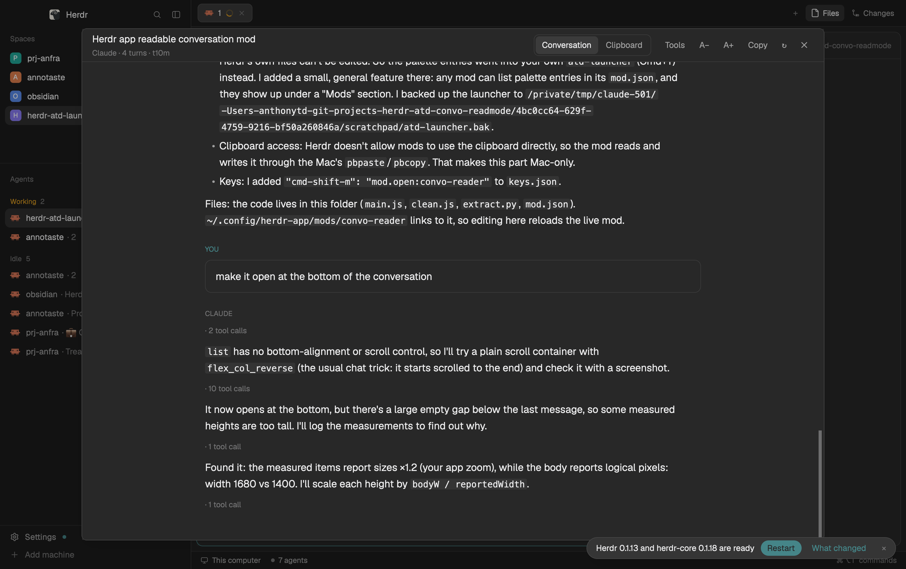
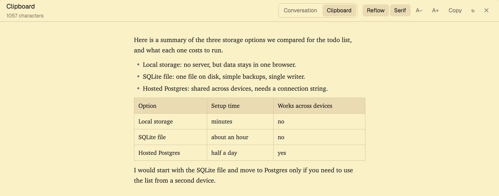

# Read Mode (`convo-reader`)

A Herdr app mod for reading an agent conversation, or text you copied from a terminal, as a proper document. Read Mode shows it in a proportional font with rendered markdown, in a centred column, instead of the terminal's monospace.



## Opening it

| How | What it opens |
|---|---|
| **Cmd+Shift+M** | Read Mode on the tab you used last, reading the terminal that had focus |
| **Cmd+Alt+M** | Read Mode docked in a sidebar (needs a layout block, see [Docking it](#docking-it-optional)). It follows whichever terminal you focus and re-reads when that agent finishes a turn. Esc, `q` or ✕ hides it |
| **Cmd+T** → type `read` → **Read Mode: Conversation** | The conversation tab |
| **Cmd+T** → type `read` → **Read Mode: Clipboard** | The clipboard tab |

The Cmd+T entries come from the `atd-launcher` palette. Herdr's built-in palette (Cmd+Shift+P) doesn't list mods, so they can't go there (see [Palette entries](#palette-entries)).

Esc, `q` or ✕ closes it.

## The two tabs

### Conversation

Shows the whole conversation of the terminal that had focus when you opened Read Mode. It **opens at the bottom**, on the newest message; scroll up for older ones.

- **Your messages** are in cards labelled *You*. Slash commands appear as chips (`/model opus`), and their output appears as small grey notes.
- **Agent replies** are rendered markdown: headings, lists, tables, inline code and code blocks.
- **Tool calls** are shrunk to one line each (`Bash  Inspect session model and types`); failed ones show in the blocked colour. **Tools** off collapses each run into "· 6 tool calls".
- **Contents** (left sidebar) lists each of your messages by its first line. Click one to jump to it. The one on screen is highlighted. `o` hides or shows it.
- Thinking blocks, system reminders, sidechains (sub-agent turns) and harness wrappers are left out.

Where the text comes from:

- **Claude Code terminals:** the session's saved conversation file, so you see the original markdown, not what the terminal drew.
- **Any other program:** the terminal's screen and scrollback (`hc read --lines 4000`), cleaned up as in the Clipboard tab. A note at the top says so.

### Clipboard



Shows the clipboard's text, turned back into readable formatting:

- Lines the terminal broke at its edge are joined back into paragraphs. Short lines the author broke on purpose stay separate.
- `•` bullets become a markdown list.
- Tables drawn with box characters (`┌─┬─┐ │ ├─┼─┤ └─┴─┘`) become real tables, and cells that wrap over several lines are joined.
- Claude Code's markers (`⏺ ● ⎿`) and input-box frames (`╭─╮ │ ╰─╯`) are removed, and the agent's indent is stripped.
- Indented code stays as code.

**Reflow** off keeps every line as copied (each one becomes a hard line break), for text where the joining guesses wrong.

The clipboard is read when Read Mode opens, when you switch to this tab, and on `r` / ↻. Copy something else while it's open, then press `r`.

## Controls

| Button | Key | Does |
|---|---|---|
| Conversation / Clipboard | `1` / `2`, `Tab` | Switch tab |
| Contents | `o` | Show or hide the sidebar listing your messages (Conversation) |
| Tools | `t` | Show tool calls one per line, or as a count (Conversation) |
| Reflow | `w` | Join hard-wrapped lines, or keep them as copied (Clipboard, terminal-text fallback) |
| Serif | `f` | Switch body text to a serif (New York, Charter, Iowan Old Style or Georgia, whichever is installed) |
| A− / A+ | `-` / `=` | Text size: 13, 14, 15, 16, 17, 18, 20, 22 px (before app zoom) |
| Copy | `c` | Put the whole view on the clipboard as markdown, ready to paste into Obsidian |
| ↻ | `r` | Read the conversation file or the clipboard again |
| ✕ | `Esc`, `q` | Close |

The tab, text size, Serif, Contents, Tools and Reflow are remembered between openings.

### Typography

The column is 36em wide (about 70 characters a line, inside the 45–75 range typographers recommend), so it narrows and widens with the text size. Lines are 1.6× the text size. On dark themes the body text is mixed 10% toward the background to cut glare. A speaker's name sits close to their message, and turns are about 2em apart, so each label clearly belongs to the message below it.

**Copy** writes a document like this:

```markdown
# Herdr app readable conversation mod

## You

`/herdr-app Plan and build a mod…`

## Claude

- *Bash* Load herdr-app skill and inspect state
- *Read* /Users/…/AGENTS.md

Looking at how to map a terminal to its Claude transcript…
```

### Extra key commands

While Read Mode is open, it also takes mod commands, which you can bind in `keys.json` or run from a shell:

```sh
herdr-app do convo-reader.conversation
herdr-app do convo-reader.clipboard
herdr-app do convo-reader.reload
```

They only reach Read Mode while it's open. To open it straight on the clipboard with its own key, use the palette entry, or open it and press `2`.

## Install

The mod is this folder, linked into Herdr's mods folder:

```sh
ln -s ~/git-projects/herdr-atd-convo-readmode ~/.config/herdr-app/mods/convo-reader
herdr-app check ~/.config/herdr-app/mods/convo-reader
```

The folder must be called `convo-reader` inside `mods/`: `main.js` finds `extract.py` at `mods/convo-reader/extract.py`.

Then add the key to the `global` section of `~/.config/herdr-app/keys.json`:

```json
"cmd-shift-m": "mod.open:convo-reader"
```

### Docking it (optional)

The Cmd+Alt+M sidebar needs a layout block that holds the mod, with `docked: true`. Add this to the `children` of an existing row in the layout you use (`~/.config/herdr-app/layouts/<name>.json`), next to the tab block:

```json
{
  "id": "readmode",
  "type": "block",
  "hidden": true,
  "size": { "px": 520 },
  "min": 360,
  "max": 1000,
  "content": { "mod": "convo-reader", "props": { "docked": true } }
}
```

Then bind a key to toggle it in the `global` section of `keys.json`:

```json
"cmd-alt-m": "layout.toggle:readmode"
```

The block's `id` must be `readmode`: ✕ and Esc hide the block by that id.

Requirements: macOS (`pbpaste` / `pbcopy`), `python3` (the system one, 3.9+, is enough), and `hc` on `PATH`.

Saving any file in this folder reloads the mod in the running app. Run `herdr-app check` after each change.

## How it works

```
cmd-shift-m ─► mod.open:convo-reader ─► main.js (dialog overlay)
                                          │
              Conversation tab ───────────┤ exec python3 extract.py <terminal>
                                          │    hc get <t> → process ids
                                          │    ~/.claude*/sessions/<pid>.json → sessionId
                                          │    <config>/projects/<cwd>/<sessionId>.jsonl → turns (JSON)
                                          │    (not Claude Code: hc read --lines 4000 → screen text)
                                          │
              Clipboard tab ──────────────┤ exec pbpaste → clean.js → markdown
                                          │
                                          └─► TextView.markdown per message
```

| File | Role |
|---|---|
| `main.js` | The overlay: header, tabs, buttons, keys, and drawing the messages |
| `extract.py` | Terminal → conversation JSON (`{kind: "transcript", title, turns}` or `{kind: "screen", text}`) |
| `clean.js` | Terminal text → markdown (unwrapping, tables, bullets, markers) |
| `mod.json` | Overlay size (82% × 90% of the window) and the palette entries |
| `docs/` | Screenshots for this README |

`gpui-kit.d.ts` and `jsconfig.json` are written by Herdr on every start. Don't edit them.

### Finding the session

`extract.py` asks `hc get <terminal>` for the terminal's shell and foreground process ids, then walks their child processes, looking for `~/.claude*/sessions/<pid>.json`. Claude Code writes one of those for each running session, with its `sessionId` and `cwd`. Because it checks every `~/.claude*` folder, sessions started with `CLAUDE_CONFIG_DIR=~/.claude-work` are found too. The conversation file is `<config>/projects/<cwd with non-alphanumerics as ->/<sessionId>.jsonl`; if it isn't there, every project folder is searched.

The terminal is the focused one. If a mod pane has focus instead, it's the agent that pane's tab shows.

### Opening at the bottom

Herdr's lazy `list` measures messages itself but can't be scrolled from code, and `v_virtual_list` can scroll but needs every item's height up front. So the Conversation tab does both:

1. The body reports its width with `on_size_change`.
2. Every message not yet measured is laid out at that width in a hidden layer behind a cover. Each one reports its height.
3. Once all heights are known, a `v_virtual_list` with those heights is shown under the cover, and `scroll_to_bottom()` is called.
4. A scroll request made before the list's first layout is dropped, because the handle doesn't know the item count yet. A 30 ms timer therefore repeats it for the next few ticks, then removes the cover. Jumps from Contents, and re-measures after a change to size, Serif, Tools or Contents, use the same retry so that they land on the right message.

Heights are stored per message, width, text size and Tools setting, so resizing the window or changing those re-measures only what's needed.

Nested elements report their size multiplied by the app zoom, while the body reports logical pixels. Each height is therefore scaled by `bodyWidth / reportedWidth`. Without that, every message gets extra space below it at any zoom other than 1.

### Palette entries

Herdr's built-in palette hides `mod.open`, and its files can't be edited. Read Mode's palette entries are declared in `mod.json`:

```json
"palette": [
  { "label": "Read Mode: Clipboard", "about": "…", "shared": { "convo-reader.mode": "clipboard" } }
]
```

`atd-launcher` was extended to read the `palette` list from every `mods/*/mod.json` and show the entries under a **Mods** section. Choosing one sets the listed `shared` values, then runs `mod.open` for that mod. Any other mod can add palette entries the same way.

## Limits

- **macOS only** for the clipboard: Herdr doesn't give mods clipboard access (`capabilities.clipboard` in `mod.json` isn't honoured), so Read Mode uses `pbpaste` / `pbcopy`, with `LC_ALL=en_US.UTF-8` so box drawing and bullets survive.
- **Only Claude Code gets the clean view.** Codex, pi and other agents use the cleaned terminal text, which is limited to what the terminal still holds (4,000 lines of scrollback).
- **Long conversations** draw every message once while measuring, so a very long session takes a moment longer to open. After that only visible messages are drawn.
- **Tool output** is not shown, only each call's description. The extractor keeps the first 1,200 characters of each result in the JSON for a future "expand" view.
- **Not live.** The conversation is read when Read Mode opens. Press `r` to pick up new messages.
- **Clipboard cleanup is a heuristic.** Prose, lists and tables come out well; unfenced code mixed with prose can be joined by mistake. Turn **Reflow** off when that happens.
- **No palette entry** in Herdr's built-in Cmd+Shift+P palette (see above).
