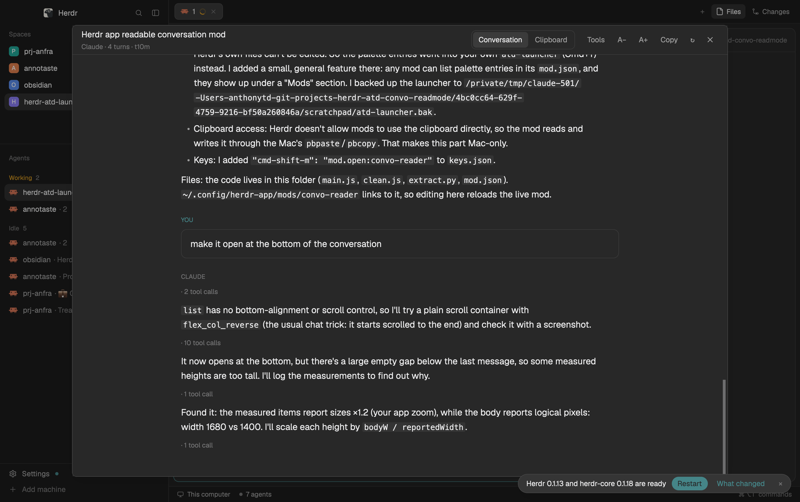

# Read Mode (`convo-reader`)

A dialog that shows an agent conversation, or text copied from a terminal, as a proper document: proportional font, rendered markdown, one centred column, instead of the terminal's monospace. Cmd+Shift+M opens it over the window; Cmd+Alt+M docks it in a sidebar that follows the focused terminal.

## What you see

- **Dialog** (`mod.json` overlay): 82% of the window wide, 90% tall, centred.
- **Header**, top: the conversation title and, under it, `Claude · 4 turns · t10m`. On the right a segmented control **Conversation | Clipboard**, then text buttons **Contents, Tools, Reflow, Serif, A−, A+, Copy, ↻, ✕** (Contents and Tools show in Conversation; Reflow in Clipboard).
- **Body**: a column 36em wide, centred, scrollable, with a scrollbar on the right. Line height 1.6 × text size. Text size steps 13, 14, 15, 16, 17, 18, 20, 22 px (default 16). On dark themes body text is mixed 10% toward the background.
- **Contents** sidebar (left, Conversation only): one entry per user message, first line only; the entry on screen is highlighted.
- **Your messages**: a small uppercase label `YOU` in the accent colour, over a rounded card with a 1px border. Slash commands are chips (`/model opus`); their output is a small grey note.
- **Agent replies**: label `CLAUDE` in muted uppercase, then rendered markdown (headings, lists, tables, inline code, code blocks). Turns sit about 2em apart; a label sits close to its message.
- **Tool calls**: one muted line each (`Bash  Inspect session model`); failed ones in the blocked colour. With Tools off, a run collapses to `· 6 tool calls`.
- **Clipboard tab**: the clipboard text, cleaned, in the same column.

## How it behaves

- Opens on the tab used last; Conversation opens **scrolled to the newest message**.
- Conversation reads the terminal that had focus (if a mod pane has focus, the agent that pane's tab shows). Claude Code terminals: the session's saved conversation file. Any other program: screen and scrollback (`hc read --lines 4000`), cleaned like the clipboard, with a note at the top saying so.
- Left out: thinking blocks, system reminders, sidechains, harness wrappers. Tool output is not shown.
- Clipboard cleanup: rejoins lines the terminal wrapped, keeps deliberate short lines, turns `•` into list items, turns box-drawing tables into markdown tables (joining wrapped cells), removes `⏺ ● ⎿` markers and `╭─╮ │ ╰─╯` frames, strips the agent's indent, keeps indented code. **Reflow** off keeps every line as copied.
- Keys: `1`/`2`/`Tab` tabs, `o` contents, `t` tools, `w` reflow, `f` serif (New York, Charter, Iowan Old Style or Georgia, whichever exists), `-`/`=` size, `c` copy, `r` reread, `Esc`/`q` close, click a Contents entry to jump.
- **Copy** puts the whole view on the clipboard as markdown (`# title`, `## You`, `## Claude`, tool calls as `- *Bash* description`).
- Tab, size, Serif, Contents, Tools and Reflow are remembered between openings.
- **Docked** (`props.docked: true`, in a layout block with id `readmode`): follows whichever terminal is focused and rereads when that agent finishes a turn. Esc, `q` and ✕ hide the block.
- Not live: the conversation is read on open; `r` rereads.
- Palette entries "Read Mode: Conversation" and "Read Mode: Clipboard" are declared in `mod.json` (`palette`, setting `shared` `convo-reader.mode`). Herdr's built-in palette does not list them; a launcher mod that reads `palette` does.

## Built from

- `mods/convo-reader/main.js`: gpui-kit (`View`, `div`, `list`), gpui-base (`v_flex`, `h_flex`, `Scrollbar`, `TextView` markdown, `v_virtual_list`, `VirtualListScrollHandle`). From `herdr`: `exec`, `appHome`, `theme`, `fonts`, `props`, `closeOverlay`, `focused`, `agents`, `panes`, `layout`, `run`, `shared`, `setShared`, `notify`, `nextCommand`.
- `extract.py` (run with `python3 -I`): `hc get <terminal>` gives shell and foreground pids; walks child processes looking for `~/.claude*/sessions/<pid>.json` (`sessionId`, `cwd`); reads `<config>/projects/<cwd with non-alphanumerics as ->/<sessionId>.jsonl`, falling back to a search of every project folder. Prints `{kind:"transcript", title, turns}` or, for other programs, `{kind:"screen", text}` from `hc read --lines 4000`.
- `clean.js`: `terminalToMarkdown`, the clipboard cleanup above.
- Clipboard through `pbpaste` and `pbcopy` with `LC_ALL=en_US.UTF-8`.
- `keys.json`: `cmd-shift-m` → `mod.open:convo-reader`, `cmd-alt-m` → `layout.toggle:readmode`.
- Opening at the bottom: the lazy `list` can't be scrolled from code and `v_virtual_list` needs heights up front. So: report the body width with `on_size_change`; lay every unmeasured message out in a hidden layer behind a cover; once all heights are known, show a `v_virtual_list` with them and call `scroll_to_bottom()`; repeat that on a 30 ms timer for a few ticks, because a scroll before the first layout is dropped; then remove the cover. Heights are cached per message, width, text size and Tools.
- Dock block for a layout (add to a row's `children`):
  `{"id":"readmode","type":"block","hidden":true,"size":{"px":520},"min":360,"max":1000,"content":{"mod":"convo-reader","props":{"docked":true}}}`

## Watch out

- **Reaches outside its folder and runs programs:** runs `python3`, `hc`, `pbpaste`, `pbcopy` through `exec`, and reads Claude Code's files under `~/.claude*/` (sessions and project transcripts). No network.
- macOS only for the clipboard (`capabilities.clipboard` in `mod.json` is not honoured). Needs `python3` 3.9+ and `hc` on `PATH`.
- The mod folder must be named `convo-reader`: `main.js` runs `mods/convo-reader/extract.py` under `appHome()`.
- Nested elements report sizes multiplied by the app zoom while the body reports logical pixels. Scale every measured height by `bodyWidth / reportedWidth`, or each message gets extra space below it at any zoom other than 1.
- A scroll requested before the virtual list's first layout is silently dropped; keep the retry timer.
- Only Claude Code gets the transcript view. Other agents get cleaned terminal text, limited to 4,000 lines of scrollback.
- Very long sessions take longer to open: every message is drawn once while measuring.
- Clipboard cleanup is heuristic; unfenced code mixed with prose can be joined by mistake (turn Reflow off).
- Docking needs the layout block above; without it Cmd+Alt+M does nothing.

## Done when

- `herdr-app check mods/convo-reader` passes.
- Cmd+Shift+M in a Claude Code terminal opens a dialog at 82% × 90% with the conversation scrolled to the last message, and no gap below it at app zoom 1.2.
- Your messages appear as labelled cards, agent replies as rendered markdown, tool calls as one line each; Tools off shows `· N tool calls`.
- Clicking a Contents entry scrolls to that message and highlights it.
- Copying a Claude Code terminal's table and opening the Clipboard tab shows a real table; Reflow off shows every line as copied.
- In a non-Claude terminal the Conversation tab shows cleaned screen text with a note saying so.
- Copy puts `## You` / `## Claude` markdown on the clipboard.
- With the dock block and `cmd-alt-m`, the sidebar toggles, follows the focused terminal, and Esc hides it.
